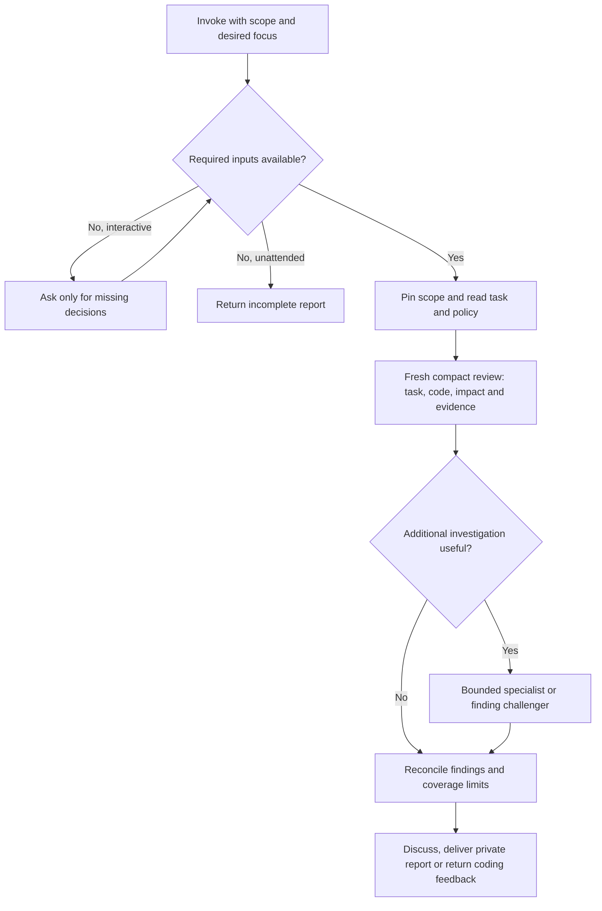

# Code reviewer

Use this skill when you want a second look at a PR, local changes or a design—not just whether the implementation matches the task, but whether the task, unintended consequences and verification stand up to scrutiny.

It replaces `vimes`. Start with one compact review; request focused expertise or an independent challenge when the change warrants it. This is a review workflow, not an auto-fixer, merge gate or installed PR bot.

## Quick start

### Claude Code: invoke the installed skill

With the `klases@luggage` plugin installed and refreshed to a revision containing this package, type this **inside Claude Code**, not in your shell:

```text
/klases:code-reviewer
```

A bare invocation asks what to review and which focus matters, unless the conversation already supplies that information. To skip the initial questions, include the request:

```text
/klases:code-reviewer Review my staged changes for unintended behavior changes and weak tests. Discuss the findings with me. Read-only.
```

Native plugin discovery and agent activation have not been exercised for this package. If the skill is not available, use explicit loading below rather than assuming the command ran. `/klases:vimes` is removed; there is no compatibility alias.

### Codex or Hermes: explicitly load the skill

In your target project's conversation, give the agent the actual file path:

```text
Read <luggage-checkout>/personal/klases/skills/code-reviewer/SKILL.md and follow it, loading its references as needed.
Review my staged changes for regressions and test gaps. Read-only; report here.
```

Replace `<luggage-checkout>` with the absolute path to your local Luggage clone. It is a placeholder, not a shell variable. The agent needs read access to both the skill package and the target project. Identify the target repository if more than one is in scope.

Explicit artifact loading was exercised through Codex. Native Codex `$code-reviewer` and named Hermes activation require host discovery/configuration and remain unverified for this package. Claude-format agent files are not automatically native agents on those hosts; see [host activation and permissions](references/hosts.md).

## When to use it

- **Review together:** inspect a PR or your own changes, then discuss individual findings and assumptions.
- **Prepare a private PR briefing:** request a self-contained report before reviewing somebody else's PR. The caller supplies authorized PR access, scope and an output destination.
- **Review during coding:** have a fresh reviewer assess the task and a frozen implementation, returning findings to the coding agent rather than editing its work.

Use a focused request for a particular question, such as authorization, transaction failures or compatibility. A broader request can include correctness, security, tests, error handling, models, documentation and simplicity. These are review focuses—not a requirement to launch an agent for every category.

## Example requests

The examples below are prompt text. Use them after loading the skill, or append them to the Claude invocation. Replace placeholder URLs, revisions and paths with your actual targets; no example authorizes running target code.

### Review a PR interactively

```text
Review <PR URL> with me. Focus on changed behavior and effects on existing callers.
Resolve and state the base and head revisions. Challenge the task assumptions as well as the code.
Show the strongest supported findings first, with open questions separate. Read-only; do not post to GitHub.
```

### Produce a private PR report

```text
Review <PR URL> and produce a private report here, not a GitHub comment.
Focus on authorization, compatibility and test quality. Pin the reviewed revisions.
Include triggering conditions, evidence, counterevidence and what was not verified.
This is unattended: return incomplete if required scope or access is missing.
```

This selects the private-report workflow described in [workflows](references/workflows.md). It does not install or invoke the separate open-source PR-Agent tool, create a schedule or grant publication permission. The package does not define a separate executable `PR-Agent` subcommand; state the desired report workflow in the request.

### Request deeper investigation

```text
Review <base>..<head> for transaction and retry regressions, including affected unchanged callers.
Use focused specialists where they add distinct evidence. Challenge consequential or disputed findings independently.
Explain whether each issue is introduced, exposes an older defect or is pre-existing. Source inspection only.
```

### Ask a coding agent for an independent review

```text
Give a fresh reviewer the agreed task and a frozen snapshot of these changes.
Have it load the code-reviewer skill and relevant references before reading my implementation summary.
Return defects, unresolved assumptions and required follow-up checks. Do not fix anything during review.
If fresh review is unavailable, disclose the reduced independence.
```

## What happens



The coordinator resolves scope, chooses the workflow and assembles the result. The main reviewer investigates the task, implementation, unintended impact and verification. A specialist handles a bounded aspect; a challenger searches for evidence that supports or defeats a consequential claim. The host and selected depth determine which roles actually run; the report must say what happened.

## What you get—and what remains separate

A report opens with a verdict (approve, approve-with-comments or request-changes), then identifies the reviewed revision and scope, supported findings with locations and triggering conditions, recommendations or owner questions, and verification/coverage limits. Impact and confidence are separate. Zero findings is valid, not proof that the change is correct.

The native Claude agents have read/search tools only. Tests, builds and targeted mutations require separate authorization and a coordinator-provided controlled execution environment. A request for a deeper review does not itself grant execution permission. Fixes, commits, pushes, GitHub comments and merge decisions are separate actions.

## Further reading

- [SKILL.md](SKILL.md): coordinating instructions.
- [Investigation](references/investigation.md): the task, implementation and verification steps every reviewer follows, including checking the change against its spec and acceptance criteria.
- [Review contract](references/review-contract.md): evidence, severity, the blocks-merge flag and candidate dispositions.
- [Workflows](references/workflows.md) and [host support](references/hosts.md): interaction, delivery and runtime limits.
- [Sources](references/sources.md) and [NOTICE.md](NOTICE.md): inspiration and adapted material.
- [Evaluation recorder](evaluation/README.md): developer tooling for input identities, budgets and report accounting; not a prerequisite for an ordinary review.
